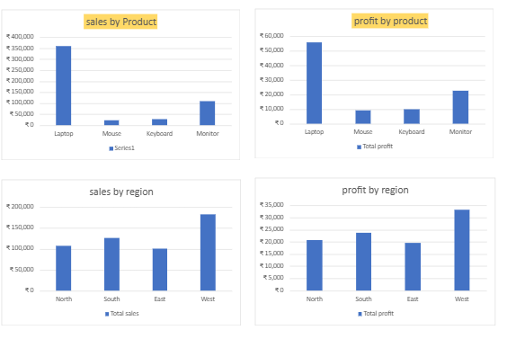

# Sales Data Analysis Using Microsoft Excel

## Project Overview
This project focuses on analyzing sales data using Microsoft Excel. The objective is to understand sales performance, product performance, regional sales, and profitability through data analysis and visualization.

## Project Objectives
- Analyze overall sales and profit.
- Identify the best-performing products.
- Compare sales across different regions.
- Calculate profit margins.
- Present key insights through an interactive-style dashboard.

## Tools and Skills Used
- Microsoft Excel
- Excel Tables
- Excel Formulas: SUM, AVERAGE, SUMIF, IF, COUNTA
- Data Formatting and Data Analysis
- Charts and Data Visualization
- Dashboard Creation

## Key Performance Indicators (KPIs)

| Metric | Result |
|---|---:|
| Total Sales | ₹516,900 |
| Total Cost | ₹419,500 |
| Total Profit | ₹97,400 |
| Total Orders | 15 |
| Average Sales | ₹34,460 |
| Total Quantity Sold | 84 |
| Profit Margin | 18.84% |

## Analysis Performed
1. Product-wise sales and profit analysis.
2. Region-wise sales and profit analysis.
3. Quantity sold analysis.
4. Overall business performance analysis.
5. Dashboard creation using charts and KPIs.

## Key Findings
- Laptop generated the highest sales.
- West region recorded the highest sales.
- Total profit was ₹97,400.
- Overall profit margin was 18.84%.

## Project Files
- `sales_data_analysis.xlsx` – Excel workbook containing the dataset, analysis, summary sheets, charts, and dashboard.

## Conclusion
This project helped me develop practical skills in Microsoft Excel, data analysis, business reporting, and data visualization.

*Note: This project uses sample data for learning and portfolio demonstration purposes.*
## 📊 Sales Dashboard

